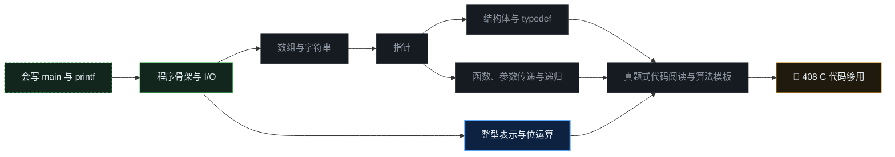

# Plan — 408 应试 C 语言

## Goal

能读懂 408 真题里出现的任何 C 代码片段（位运算、指针、数组、结构体、递归），
能按 408 数据结构题的风格写出正确的 C 代码（顺序表、链表、树/图的基本操作），
考试够用即止——不追求工程化、不学文件 I/O 与构建系统。

## Probe result

| strand | status |
|--------|--------|
| 摸底 | 跳过（学员此前学过 c1 类型与运算，选择直接开讲） |

## Dependency map

## Chunks

| # | chunk | 核心内容 | 408 用在哪 | status |
|---|-------|----------|-----------|--------|
| c1 | 程序骨架与 I/O | `#include`、`main`、`printf/scanf` 格式符、变量作用域与生命周期 | 读代码题、程序输出题 | ✅ |
| c2 | 整型表示与位运算 | 补码、溢出、移位、位掩码、`& | ^ ~ << >>` | 计组（数据表示）、计网（子网划分） | ✅ 已讲，检查题待答 |
| c3 | 数组与字符串 | 一维/二维数组、下标与地址、字符数组与 `'\0'`、`strlen/strcpy` | 顺序表、串的模式匹配 | 📄 讲义已出 |
| c4 | 指针 | 指针与数组的等价、指针运算、指针作参数、`malloc/free` 概念、二级指针点到为止 | 链表、树、图的实现基础 | 📄 讲义已出 |
| c5 | 结构体与 typedef | 结构体定义、`->`、结构体数组、链表结点、typedef 写法 | 408 数据结构算法题标准写法 | 📄 讲义已出 |
| c6 | 函数、参数传递与递归 | 值传递 vs 指针传递、递归与栈、递归转非递归 | 递归算法、栈的应用题 | 📄 讲义已出 |
| c7 | 真题式代码阅读与算法模板 | 判断题/填空题套路、常见输出陷阱、顺序表与链表模板 | 综合题、算法设计题 | 📄 讲义已出 |

**刻意不学**：文件 I/O、Makefile、调试器、多文件工程、复杂宏——408 不考。
